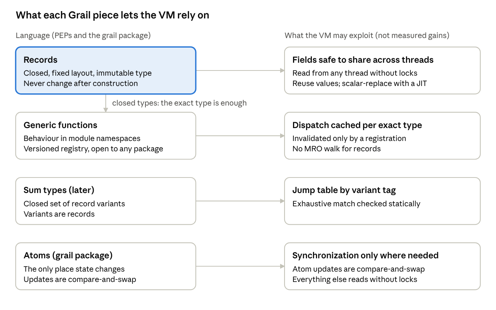

# Project Grail

Oct 25, 2026 · @Neil Schemenauer

> "What… is your quest?"\
"To seek the Holy Grail."
>
> — The Bridge of Death, *Monty Python and the Holy Grail*

Project Grail is a long-term effort to give Python a new object model that an efficient VM, and eventually a JIT, can rely on, without turning Python into a static language. If the Grail is found, we will gain: closed record types for data, generic functions for behaviour, algebraic data types for closed sets of alternatives, and persistent collections, so that state which changes over time is a sequence of immutable values rather than a mutable container. Together they let many programs be written without `class`, and give the VM guarantees it can rely on. The measured payoff so far is in sharing values across threads and reusing them instead of copying; record-heavy single-thread code beats well-written mutable classes, but immutable numeric updates lag. Larger single-thread gains, such as unboxed fields and eliminated allocations, would need a JIT and remain unproven: the prototype now runs under CPython's JIT, but the JIT does not yet exploit Grail's guarantees, so record-heavy idiomatic Grail versions gain no more from it than the original programs do. Extensions get an extended C API, efficient but safer than today's, one that hides more implementation details.

Grail is delivered as a series of PEPs. This tab explains the whole system and how the parts fit. PEP drafts have their own tab. We want to lift proven features from other languages, not invent.

## How mature each draft is

The drafts are at different stages. Read the earlier ones as proposals ready for serious critique and the later ones as sketches.

| Tab | Maturity | Notes |
| --- | --- | --- |
| PEP draft: Records | Fairly solid | The most worked-over draft. Ready for review. |
| PEP draft: Generic functions | Less settled | The overall approach is agreed; the details still need work. |
| PEP draft: Record syntax | Fairly solid, with one big open question | Whether to use per-construction defaults or PEP 671's `=>` late-bound defaults is unresolved. |
| PEP draft: C API | Very provisional | Mostly AI-generated. Skimmed, not yet reviewed or refined. |
| Design: Persistent collections | Very provisional | Mostly AI-generated. Skimmed, not yet reviewed or refined. Native HAMT map/set, trie vector and boxed Atom imported; typed conformance and optimized builders remain open. |
| CPython prototype | Status report | Not a PEP. Prototype status, what it shows, remaining implementation gaps, and design refinements. |
| Appendix: Concurrency toolkit | Proposed, outside the core scope | Library built on Grail's values and atoms; written from the benchmark studies; not yet reviewed. |

The C API and Persistent collections drafts look reasonable at a skim but need real review and polish before anyone should take them too seriously.

## What holds the VM back today

Python's object model lets almost anything change at any time, so the VM must guard against many things:

- **Many type objects are mutable.** Replacing a method or attribute while code runs requires affected lookup specializations to guard and invalidate their assumptions.
- **Many instances carry a `__dict__`.** CPython already specializes dictionary-backed and slotted attributes, but mutable layouts/bindings require guards and safe reference acquisition. Grail's incremental opportunity is stronger immutability, not the first fixed-offset load.
- **Subclassing can change any lookup.** A call on an object of type `T` may hit an override in any subclass, so dispatch cannot be resolved from the static type.
- **`__eq__` and `__hash__` promise little.** The VM cannot assume equal objects are interchangeable, so it cannot copy, merge or eliminate objects.
- **Identity is observable everywhere.** Any object may be compared with `is` or passed to `id()`, so the VM cannot copy an object or keep it in registers without proving nobody looks.
- **Shared mutable state is the default.** Under free threading, any object may be mutated by another thread, so reads need synchronization or must be proven safe.
- **The C API exposes the implementation.** Struct layouts, macros that read fields at fixed offsets, and borrowed references are baked into compiled extensions, so the VM cannot change an object's layout, lifetime or locking without breaking them. Much of what has slowed free threading and a faster object layout is what extensions are allowed to touch.

CPython's specializing interpreter already handles the common, well-behaved cases well: slotted attribute loads, method calls and dictionary-backed attributes are cheap when nothing changes. The remaining costs show up mainly under free threading, when copying, and in what a future JIT could prove.

## What Grail changes

| Grail changes | So the VM may |
| --- | --- |
| Records are closed: fixed fields, no `__dict__`, no subclassing, immutable type object | Resolve dispatch from the exact type. Fixed-offset field loads gain little over slotted classes, which CPython already specializes |
| Records never change after construction | Read fields with plain loads, from any thread |
| Behaviour lives in generic functions in module namespaces, not class namespaces | Cache dispatch per exact type, invalidated only by an explicit registration |
| Identity of records is implementation-defined, as for `int` and `str` | Copy, intern and deduplicate records; scalar replacement needs a JIT |
| Changing state lives in explicit cells (atoms) | Know exactly which reads need synchronization |
| Collections in records are persistent maps, sets and vectors, updated by producing new versions | Keep records that hold collections as value records, and share every version across threads without locks |
| Extensions use an opaque C API: field handles instead of offsets, builders instead of in-place initialization, strong references only, stable ABI only | Change layouts, unbox and flatten fields, and evolve the runtime without breaking compiled extensions |

The gains are most speculative at this time, we will need to measure. In the [prototype](06-cpython-prototype.md), records clearly beat frozen dataclasses and generic dispatch beats `functools.singledispatch`, and against mutable slotted classes record-heavy code is about 1.2-2.3x faster, but immutable numeric updates are still much slower than in-place updates. The clear wins are deepcopy (conforming values are reused) and multi-threaded sharing. Under CPython's JIT (GIL build) the idiomatic Grail versions keep their lead over mutable slotted classes, but the JIT speeds them up no more than the originals, and Richards falls behind its original.

What Grail keeps, preserving the Python feel:

- **Dynamic, open extension.** Any package may register an implementation for any type; there is no orphan rule and no global sealing.
- **Annotations stay optional.** A record field without a value-type annotation is an ordinary field, like a frozen dataclass field, so quick scripts need no annotations.
- **`==`, `is` and `id()` behave as Python users expect.** Only whether two separately produced substitutable records are the same object becomes unspecified; equality alone is not sufficient.
- **No new syntax is required.** Records and generic functions are decorators; record syntax is a later convenience.
- **Classes stay.** They interoperate with generic functions, and remain the tool for mutable objects with behaviour of their own.

## Overview of the pieces

Records are the foundation: because a record type is closed and immutable, a generic function can dispatch on its exact type alone, and sum-type variants inherit every record guarantee. Atoms make shared updates explicit. Thread-confined scratch objects and mutable ordinary fields may still change; those objects retain Python's normal synchronization requirements.

## Concurrency and memory model

Free threading is a goal of Grail: Grail objects can be shared across threads without data races, and the VM can read them without synchronization. Python has no documented memory model yet; PEP 583 sketched one and was withdrawn, and a [2026 discussion](https://discuss.python.org/t/define-a-concurrency-model-aka-memory-model-for-python/108762) is drafting one for both builds. Grail does not define the memory model for all of Python. It puts records and generic functions on a precisely specified foundation that fits whatever CPython adopts, and steers user code toward race-free patterns.

The proposed guarantees and implementation targets are below. The [prototype report](06-cpython-prototype.md) records the current state: publication requires synchronized transfer, exact and cached generic reads and Atom reads are lock-free, and shared-refcount elimination on values is not implemented.

| Object | Guarantee | Cost |
| --- | --- | --- |
| Record | After synchronized reference transfer, the receiver sees all fields initialized and owns a valid reference | Transfer/acquisition protocol; a stronger final-field rule for racy transfer remains open |
| Record field | Binding never changes after publication, so its pointer can be loaded without a mutation check | Child reference acquisition may still touch refcounts; mutable children need their own synchronization |
| Generic function | Registration is atomic: a racing call sees the old table or the new one, never a mix; a completed registration is seen by subsequent calls ordered after it by synchronization | Atomic snapshot publication with QSBR reclamation; writers serialize. The prototype's exact and cached reads take no lock |
| Atom (`grail` package) | Linearizable `reset`, `swap`, `compare_and_set`; `add` is proposed | Prototype: boxed reference replaced by atomic compare-exchange and read lock-free; `swap` runs callbacks without a lock and may retry |
| Channel (proposed: `queue.SimpleQueue`) | Safe to share; a `put` happens-before the `get` that receives it | A lock or lock-free queue operation |
| Cached record hash (optional) | Cache only when field and override behavior makes repeated results stable | Implemented for conforming value records with the default hash; invalidated by any `grail.hash` registration |
| Ordinary field | Nothing beyond what CPython guarantees for the object it holds | None |
| Persistent collection (grail package) | Published storage is immutable; mutable elements remain ordinary objects; transients are thread-confined | Synchronized transfer and reference acquisition still apply; shared iterator state may lock |

The ordinary-field row is the explicit boundary of Grail's safety. A mutable object in an ordinary field of a record shared between threads is a warning sign that linters can flag; the safe pattern is an atom holding an immutable value. Atom updates must be pure, because `swap` may run its function more than once; state updated together with side effects needs a lock-owning cell such as Rust's `Mutex<T>`, an open question below.

What this buys a free-threaded VM: immutable type objects need no invalidation while code runs; proven acyclic instances may avoid GC tracking only after auditing type/metadata/default edges (the prototype tracks all records); and substitutability lets the VM give each thread its own copy of a hot shared record, attacking reference-count contention.

**Proposed: no shared refcount writes on shared values.** Acquiring references to non-immortal children can write shared cache lines even when the record's bindings never change. This is a potential scaling cost, distinct from mutation safety. With dispatch locks now removed, the prototype must isolate it, using shared-scene and per-thread-scene experiments rather than assuming a benefit.

Shim-era studies point the same way, though they predate the native runtime and need re-measurement:

- **raytrace:** on 3.14t, 2 threads over one shared scene ran at 0.9-1.06x of 1 thread. With a private copy of the scene per thread they ran 1.5x.
- **buildgraph:** int constants that were not immortal, because the code was compiled from source rather than loaded from a `.pyc`, made every entry 25x slower on 28 threads.

This goes beyond permission to copy values. The CPython prototype should commit to it as a quality-of-implementation requirement: reading a value record, a value constant, or anything reachable only through them, from a thread other than the one that created it, never writes a shared reference count. Candidate mechanisms are immortalizing or deferring the refcount of a value when it is first published to another thread, per-thread copies, and immortal code constants however the code was loaded. Which mechanism to use is for the prototype to measure. The language specification stays as it is; this is the part of the design the parallel speedups depend on.

The CPython prototype has not yet tested this. With lock-free dispatch, native raytrace scales about 2.9x on 8 threads; the shared-scene refcount experiments come next (tab: CPython prototype). An appendix (tab: Appendix: Concurrency toolkit) sketches library support that can be built on top: a write-once `Promise`, independent random streams, and a low-overhead executor based on spinningjenny.

## Design principles

- **Data, behaviour and alternatives are separate.** Records hold data, generic functions hold behaviour, sum types hold closed alternatives. Records have no methods; single dispatch is the way to add behaviour.
- **Closed and immutable by default, explicit when not.** A value annotation is not enforced: the runtime may inspect it to prove per-instance conformance. Only conforming value records get transitive value permissions. Ordinary fields retain their objects' semantics; shared updates should use atoms or other synchronization.
- **Open extension stays.** Any package may register implementations for any type. Duplicate registrations are errors unless explicitly overridden.
- **Identity is not a promise for records.** The VM may substitute one record for another when they are substitutable: same exact type, same field representations. Substitutability is a relation in the specification, stricter than `==`, not a public function.
- **Optimizations are hypotheses.** The VM case is measured in a CPython fork before any PEP claims it, starting with an audit of where CPython relies on pointer identity.
- **No syntax until it pays.** Everything works as decorators first; syntax arrives later as sugar.
- **Borrow, don't invent.** Valhalla for value semantics and substitutability, Clojure for atoms, values and persistent collections, Bagwell and CHAMP for hash tries, CLOS, Dylan and Julia for generic functions, Rust, Swift and Scala for sum types.

## Roadmap

| Step | What it adds | Depends on | Status |
| --- | --- | --- | --- |
| PEP: Records | `@grail.record`: closed record types, value and ordinary fields, identity and substitutability rules, copy and pickle rules, concurrency guarantees | Must be approved together with Generic functions | Draft (tab: PEP draft: Records) |
| PEP: Generic functions | `@grail.generic`, `@g.impl`, `@g.override`, exact-pair operator dispatch, builtin protocol hooks | Must be approved together with Records | Draft (tab: PEP draft: Generic functions) |
| PEP: Record syntax | The `record` statement, with defaults evaluated at each construction | Records | Draft (tab: PEP draft: Record syntax) |
| Sum types | `enum` of record variants; exhaustive `match` checked by type checkers | Records, Generic functions | Later |
| Atoms and persistent collections | `Atom[T]` with `add` for counters, `bind` for `contextvars`, and persistent `PMap`, `PSet` and `PVector`, and unboxed `FloatVector`/`IntVector` (tab: Design: Persistent collections) | Records | Native collections, flat numeric vectors and boxed Atom imported; `add`, `bind`, typed conformance and optimized builders remain proposed |
| Deriving and method-call export | `deriving (...)`, `p.area()` as sugar for `area(p)` | Generic functions | Prototype has element-wise `+ - * /` for all-float records (`@grail.record(deriving=...)`); method-call export later |
| PEP: C API | Extensions define record types, build and read records, and define and extend generic functions; opaque types, field handles and builders, stable ABI only | Records, Generic functions; proposed once their Python-level semantics settle | Draft (tab: PEP draft: C API) |

Records have no methods, so a record type gets its `repr`, custom `==`, ordering and operators only through generic functions. The Records and Generic functions PEPs therefore have to be approved together. If Generic functions were not accepted, the Records PEP would need revising to work without it.

## Delivery

1. **The CPython prototype.** This is being developed now. `cpython-grail` implements records, generic functions, operators, collections and atoms in C. All current implementation testing and runtime measurements target this fork: the free-threaded build for sharing and scaling, and a GIL-enabled build for the JIT. Its status and validation limits are in the [prototype report](06-cpython-prototype.md); unboxing, allocation elimination and the full identity-use audit remain future work.
2. **A compatibility implementation.** This is planned for later. A new `grail` distribution could support decorator-form records, generics, operators and atoms on older Pythons. Its implementation, supported subset and performance have not been established. Optional native runtime pieces and a `record` import hook remain proposals, not current testing infrastructure.
3. **PEPs.** Records and Generic functions proposed together, then Record syntax, then the later steps. Reference implementations and compatibility claims should follow tested implementations, not precede them.

Before the first PEP, take prototypes to reviewers: the CPython specializer and JIT teams, CinderX, PyPy, NumPy and scientific Python stack, pandas and Polars, Pydantic, the type checkers, linters, and IDE maintainers.

## Cross-cutting open questions

- **Identity-use audit.** How much copying, interning and scalar replacement CPython's internals actually allow; this decides the size of the VM win. Highest priority.
- **A lock-owning cell.** Atoms need pure update functions. Should Grail add a `Locked[T]` cell, Rust `Mutex<T>` style, whose contents are reachable only while the lock is held, for state updated together with side effects?
- **Alignment with CPython's memory model.** Specify both reference publication and receiver ownership/acquisition. A constructor release fence alone cannot make arbitrary racy C pointer transfer safe. Synchronized transfer is the current baseline; a stronger final-field rule needs separate design and validation.
- **Reference-count contention.** Measure it in the native prototype, now that dispatch locks are gone. Compare safe deferred reference counting, per-thread copies and other lifetime-preserving mechanisms before choosing how to meet the proposed sharing goal.
- **Shared concurrent maps.** Proposed decision: a map that threads must read while others update it (a cache, a dedup table) is outside the Grail subset for now. Use a library such as cereggii's `AtomicDict`, or an `Atom[PMap]` when writes are rare. For aggregation, prefer a private fold per thread plus a merge; compare its costs with shared-update alternatives on the native prototype.
- **Type-checker support for generic functions.** Checkers handle `singledispatch.register` poorly today; a typing spec is needed, not per-checker plugins.
- **Unchecked ordinary fields.** `Account("ann", 0)` stores an `int` in a field annotated `Atom[int]` and fails only at first use; revisit a shallow runtime check.

Each PEP draft keeps its own open issues. The working notes tab holds the full design history and the earlier checklist; the archive tab holds the original proposal.
